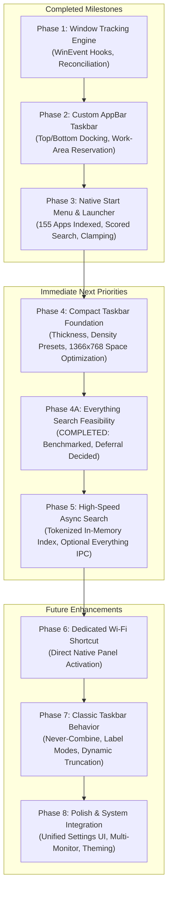

# StartAllForward — Unified Product Roadmap

**StartAllForward** is an independent, free, and open-source Windows customization application and taskbar daemon built in **Rust**.

Inspired by the functionality of StartAllBack, StartAllForward provides a clean-room, standalone user-mode alternative with zero DLL injection, zero registry patching, and standard unprivileged execution.

---

## 1. Product Vision & Core Principles

1. **Maximum Practical Compactness & Screen-Space Efficiency**:
   - Designed primarily for constrained laptop displays (acceptance baseline: **1366×768 Windows 11 laptop**).
   - Recovers critical vertical pixels lost to bulky modern shell components through adjustable taskbar thickness, tight padding, and compact density presets.
2. **Native Windows 11 Aesthetic**:
   - Matches modern Windows 11 visual language (dark/light themes, Segoe UI typography, rounded geometry, subtle border and hover feedback).
3. **Classic, Predictable Taskbar Usability**:
   - Restores classic taskbar workflows that power users rely on: never-combine window labels, instant task switching, dedicated quick shortcuts, and fast application launching.
4. **Strict System Safety & Zero Shell Corruption**:
   - **Out-of-process architecture**: Never injects DLLs into `explorer.exe` or third-party processes.
   - **Zero administrative privileges**: Runs completely in standard user mode.
   - **Failsafe coexistence**: Uses standard Windows APIs (`SHAppBarMessage`, `SetWinEventHook`, `ShellExecuteExW`). Exiting StartAllForward cleanly restores the full native desktop workspace without requiring an Explorer restart.

---

## 2. Roadmap Overview

---

## 3. Detailed Phase Breakdown

### Phase 1: Observational Window Tracking Engine
- **Status**: **Completed & Verified**
- **Artifacts**: [`crates/startallforward-core`](file:///D:/My-Repos/startallforward/crates/startallforward-core), [`crates/startallforward-windows/src/service.rs`](file:///D:/My-Repos/startallforward/crates/startallforward-windows/src/service.rs), [`crates/startallforward-windows/src/hook.rs`](file:///D:/My-Repos/startallforward/crates/startallforward-windows/src/hook.rs)
- **Delivered Capabilities**:
  - Dedicated background Win32 message pump with `SetWinEventHook` (`WINEVENT_OUTOFCONTEXT`).
  - Shell window eligibility filtering (WS_VISIBLE, WS_EX_TOOLWINDOW, WS_EX_APPWINDOW, owner/child hierarchy, DWM cloaking).
  - Background periodic reconciliation loop (2.5s) to self-heal missed events.
  - Reactive `WindowTracker` model managing window lifecycle and active foreground transitions.
  - Verified with 6 automated integration tests.

---

### Phase 2: Custom AppBar Taskbar Prototype
- **Status**: **Completed & Verified**
- **Artifacts**: [`crates/startallforward-windows/src/taskbar_window.rs`](file:///D:/My-Repos/startallforward/crates/startallforward-windows/src/taskbar_window.rs), [`crates/startallforward-windows/src/appbar.rs`](file:///D:/My-Repos/startallforward/crates/startallforward-windows/src/appbar.rs)
- **Delivered Capabilities**:
  - Native borderless top-level taskbar window with double-buffered GDI rendering.
  - Desktop work area reservation via `SHAppBarMessage(ABM_NEW / ABM_QUERYPOS / ABM_SETPOS / ABM_REMOVE)`.
  - Top and bottom monitor edge docking.
  - Live window buttons showing extracted application icons, titles, and active state highlights.
  - Interactive window activation (click to focus or minimize via `SetForegroundWindow` / `ShowWindow`).
  - StartAllForward Start button (`◆ Start`) and live digital clock.
  - DPI-aware scaling and clean shutdown unregistration.

---

### Phase 3: Native Start Menu & Application Launcher
- **Status**: **Completed, Audited & Accepted** (Commit [`64e8179`](https://github.com/MRQ67/StartAllForward/commit/64e8179))
- **Artifacts**: [`crates/startallforward-windows/src/start_menu_window.rs`](file:///D:/My-Repos/startallforward/crates/startallforward-windows/src/start_menu_window.rs), [`crates/startallforward-windows/src/app_discovery.rs`](file:///D:/My-Repos/startallforward/crates/startallforward-windows/src/app_discovery.rs), [`crates/startallforward-windows/src/launcher.rs`](file:///D:/My-Repos/startallforward/crates/startallforward-windows/src/launcher.rs)
- **Delivered Capabilities**:
  - Dedicated native popup Start Menu with Windows 11 dark styling.
  - Discovery of 155+ desktop shortcut applications across User and Common Start Menu folders via COM `IShellLinkW` and `IPersistFile`.
  - Packaged modern application integration (Settings, Terminal, Calculator) via `IApplicationActivationManager`.
  - Scored search matching (exact, prefix, word-boundary, substring) with keyboard navigation (`Up`, `Down`, `Enter`, `Escape`, `Tab`).
  - Pinned applications and "All Apps" view tabs.
  - Configuration persistence under `%LOCALAPPDATA%\StartAllForward\settings.json` with corruption recovery.
  - Monitored work-area vertical clamping on 1366×768 resolution.
  - Start button toggle deactivation debounce and empty taskbar click dismissal.

---

### Phase 4: Compact Taskbar Foundation (Immediate Next Milestone)
- **Status**: **Ready for Implementation**
- **Objective**: Establish maximum practical horizontal taskbar compactness and screen-space efficiency on constrained displays (1366×768 laptop baseline).
- **Key Features**:
  1. **Configurable Taskbar Thickness**:
     - Support heights from ultra-compact (28px) to comfortable (48px).
  2. **Density Presets**:
     - **Ultra-Compact**: 28px bar height, 16px icons, 4px horizontal padding. Targets maximum vertical workspace.
     - **Compact**: 30px bar height, 16px icons, 6px horizontal padding. Balances tight density with click ergonomics.
     - **Balanced / Default**: 38px–42px bar height, 20px–24px icons, 8px horizontal padding. Balances usability and modern aesthetic.
     - **Comfortable**: 48px bar height, 24px–32px icons, 12px horizontal padding. Touch/high-DPI friendly.
  3. **Configurable Geometry**:
     - Custom user overrides for bar thickness, icon size, button padding, and inter-item spacing.
  4. **Dynamic Resizing & Live Update**:
     - Recompute `ABM_SETPOS` on the fly without application restart.
     - Adjust desktop work area smoothly when switching density presets.
  5. **Persistence**:
     - Store density mode and custom dimensions in `settings.json`.
- **Dependencies & Technical Scope**:
  - `crates/startallforward-core/src/launcher_models.rs`: Add `TaskbarSettings` struct.
  - `crates/startallforward-windows/src/taskbar_window.rs`: Dynamic DPI and geometry recalculation.
  - `crates/startallforward-windows/src/appbar.rs`: Dynamic `ABM_SETPOS` updates.
- **Risks & Mitigations**:
  - *Risk*: Icon visual degradation when downscaling 32px icons to 16px.  
    *Mitigation*: Use `SHGetFileInfoW` with `SHGFI_SMALLICON` or GDI high-quality stretch blit (`HALFTONE`).
  - *Risk*: Touchpad click targets becoming too cramped.  
    *Mitigation*: Maintain minimum 28px vertical target and configurable horizontal padding.
- **Measurable Acceptance Targets**:
  1. **Usable Work-Area Height Targets** (measured on a single 1366×768 display without a second coexisting taskbar):
     - **Ultra-Compact (28px)**: Target ≥ **740px** usable vertical height (`768 - 28`).
     - **Compact (30px)**: Target ≥ **738px** usable vertical height (`768 - 30`).
     - Both represent measurable improvements over native Windows 11 default (`768 - 48 = 720px`).
  2. Switching presets via CLI argument (`--preset compact`) or settings immediately resizes the taskbar and updates the desktop work area without crashing or leaking GDI resources.
  3. Pinned, active, and clock elements scale their internal layouts proportionally.

---

### Phase 4A: Everything Search Feasibility
- **Status**: **Completed Feasibility Study** (See report in session records)
- **Key Decisions & Empirical Baseline**:
  1. **In-Memory Baseline Measured**: 155 discovered apps search in **1.2 ms – 1.9 ms** (unoptimized debug build). Pure in-memory search is reliable and fast enough for Start Menu applications.
  2. **Scaling Bottleneck Identified**: Scaling to 2,000 items with naive lowercase allocations increases latency to **20 ms – 43 ms**, indicating that search must move off the UI thread and use precomputed lowercase tokens.
  3. **Everything CLI (`es.exe`) Rejected**: Process spawn latency (**25 ms – 60 ms**) per keystroke introduces noticeable typing lag, and `es.exe` is not bundled with standard Everything installations.
  4. **Everything Low-Level IPC (Unverified Local Latency Estimate)**: Vendor documentation and typical local Win32 IPC indicate sub-millisecond to ~1–5 ms `WM_COPYDATA` messaging without third-party DLLs. However, this latency remains an **unverified estimate** because the interactive desktop client (`Everything.exe`) was not running in the active user session on the acceptance test machine (`EVERYTHING_IPC_WNDCLASS HWND == 0`; service was running in Session 0 only).
  5. **Strategic Decision**: **DEFER Everything search integration.** Focus first on optimizing native in-memory search and asynchronous worker coordination in Phase 5.

---

### Phase 5: High-Speed Asynchronous Search & Extended Discovery
- **Status**: **Planned**
- **Objective**: Deliver non-blocking Start Menu search with expanded native Windows tool discovery and optional Everything IPC.
- **Key Features**:
  1. **Asynchronous Query Coordinator**:
     - Move search execution to a background worker thread.
     - 60ms keystroke debounce to suppress intermediate queries during fast typing.
     - Atomic query sequence tagging to discard stale responses.
     - Post-message (`WM_SEARCH_RESULTS_READY`) notification to keep the Win32 UI thread running at 60+ FPS.
  2. **Optimized In-Memory Index**:
     - Precompute lowercase tokens and pre-allocated search caches in `AppItem`.
     - **Latency Target**: Target `< 100 µs` for 1,000 items (design target compared to currently measured ~1.2–1.9 ms unoptimized search).
  3. **Expanded Native System Discovery**:
     - Enumerate `%SystemRoot%\System32` administrative utilities (`regedit.exe`, `dxdiag.exe`, `cleanmgr.exe`, `mstsc.exe`, `powershell.exe`).
     - Enumerate Microsoft Management Console snap-ins (`.msc`: `services.msc`, `diskmgmt.msc`, `eventvwr.msc`).
     - Enumerate full installed modern Windows Store apps via WinRT `Windows.Management.Deployment.PackageManager`.
  4. **Optional Everything IPC Provider (Opt-In Toggle)**:
     - Pluggable `SearchProvider` trait.
     - Pure Win32 `WM_COPYDATA` queries to `EVERYTHING_IPC_WNDCLASS` if running.
     - Constrained search syntax (`ext:exe;lnk;msc <query> !unins* !help*`).
     - Strict deduplication against primary Start Menu shortcuts.
- **Dependencies**: `windows-rs`, `crossbeam-channel`.
- **Measurable Acceptance Criteria**:
  - UI maintains uninterrupted 60 FPS while typing at > 100 WPM in the search box.
  - Zero application freeze if Everything is killed mid-query or times out.
  - System utilities (`regedit`, `services.msc`) appear and launch correctly without manual Start Menu shortcuts.

---

### Phase 6: Dedicated Wi-Fi Shortcut
- **Status**: **Planned (Requires Windows 11 Validation)**
- **Objective**: Provide an optional, direct taskbar trigger to access the native Windows Wi-Fi network panel without navigating nested menus.
- **Problem Statement**:
  - Windows 11 merged Network, Volume, and Battery into a single monolithic "Quick Settings" button (`Win + A`). Selecting a Wi-Fi network requires opening Quick Settings and clicking the small chevron next to Wi-Fi.
- **Key Features**:
  1. **Dedicated Taskbar Wi-Fi Button**:
     - Optional separate icon in the system tray area next to the clock.
     - Real-time connectivity state (Connected, Disconnected, Signal strength) using lightweight read-only queries via `wlanapi.dll` or `INetworkListManager`.
  2. **Candidate Activation Methods (To Be Validated)**:
     - *Candidate A (URI Protocol)*: `ShellExecuteExW("ms-availablenetworks:")`. While this is the registered Available Networks protocol, modern Windows 11 builds (build 22000+) vary in whether it invokes a standalone flyout, redirects to Quick Settings, or opens `ms-settings:network-wifi`. This method must be empirically validated on Windows 11 before adoption.
     - *Candidate B (Deep-Link URI)*: Direct invocation of `ms-settings:network-wifi` as a reliable fallback.
     - *Candidate C (Shell Shortcut)*: Emulating the network quick-action keystroke sequence if supported by the OS shell.
  3. **Preservation of Quick Settings**:
     - Keeps the combined Quick Settings button intact for users who want volume and battery controls.
- **Dependencies**: Windows Shell URI handlers, optional `wlanapi.dll`.
- **Measurable Acceptance Criteria**:
  - Investigation task conclusively establishes which activation candidate works reliably on Windows 11.
  - Once implemented, clicking the Wi-Fi icon displays network selection in **< 300 ms**.
  - Show/hide toggle in settings persists across restarts.

---

### Phase 7: Classic Taskbar Behavior & Window Button Management
- **Status**: **Planned**
- **Objective**: Deliver classic taskbar button grouping, text labeling, and task management based on user preference.
- **Key Features**:
  1. **Grouping / Combining Modes**:
     - **Never Combine**: Each application window has its own button with icon and full title text (Classic Windows style).
     - **Always Combine**: One button per application group with icon only (or badge count), left-click toggles or cycles through group windows.
     - **Combine When Taskbar is Full**: Displays separate labeled buttons until available horizontal width is saturated, then dynamically collapses oldest groups.
  2. **Dynamic Text Ellipsis & Layout**:
     - Calculate button widths dynamically based on monitor resolution (1366px), button count, and padding.
     - Render title text with GDI `DT_END_ELLIPSIS` and clear text padding.
  3. **Window Task Operations**:
     - Right-click context menu on taskbar buttons (Close, Minimize, Maximize, Restore).
     - Middle-click to close window or spawn new instance (`Shift + Left Click`).
     - Window flashing state notifications (`HSHELL_FLASH` / `FLASHWINFO`).
- **Dependencies**: `WindowTracker`, double-buffered GDI button layout engine.
- **Measurable Acceptance Criteria**:
  - Dynamically switches between Never Combine and Always Combine modes without taskbar redraw glitching.
  - On a 1366px screen with 15 open windows, buttons scale down gracefully without overflowing the bar.

---

### Phase 8: Polish, Unified Settings & System Integration
- **Status**: **Planned**
- **Objective**: Enterprise-grade reliability, user configuration, theming, and multi-monitor support.
- **Key Features**:
  1. **Unified Settings Window**:
     - Interactive configuration interface to adjust taskbar density presets, theme colors, search providers, pinned applications, and behavior toggles.
  2. **Theme Integration**:
     - Automatic detection of Windows Light/Dark theme (`AppsUseLightTheme`) and system accent colors (`AccentColor`).
     - Custom palette overrides in `settings.json`.
  3. **Multi-Monitor Support**:
     - Secondary taskbar instances on additional monitors via `EnumDisplayMonitors` and per-monitor `AppBarManager`.
  4. **System Tray Expansion**:
     - Observed system notification area icons (`Shell_NotifyIcon` integration or embedded notification proxy).
  5. **Packaging & Deployment**:
     - Single self-contained portable executable.
     - Clean MSIX or WiX installer with complete rollback on uninstall.
- **Measurable Acceptance Criteria**:
  - Zero memory leaks over 24-hour continuous execution.
  - Multi-monitor setups correctly reserve work areas independently on primary and secondary displays.

---

## 4. Phase Comparison & Dependency Matrix

| Phase | Milestone | Priority | External Dependencies | Primary Risk | Feasibility Status |
|---|---|---|---|---|---|
| **Phase 4** | Compact Taskbar Foundation | **Immediate Next** | None (Native Win32/GDI) | Icon downscaling visual quality at 16px | **100% Feasible** (Documented APIs) |
| **Phase 4A** | Everything Search Feasibility | Completed | None | External dependency availability | **Completed** (Report filed; deferred. IPC latency unverified locally) |
| **Phase 5** | Async Search & Extended Discovery | High | `windows-rs` COM | Thread synchronization & debounce | **High** (Standard Rust concurrency) |
| **Phase 6** | Dedicated Wi-Fi Shortcut | Medium | Shell URI / WLAN API | Flyout protocol compatibility across Windows 11 builds | **Candidate Stage** (Activation candidates require validation) |
| **Phase 7** | Classic Taskbar Behavior | High | None (Native Win32) | Geometry math on small screens | **High** (GDI layout engine) |
| **Phase 8** | Polish & Unified Settings | Future | None | Multi-monitor DPI divergence | **High** (Per-monitor DPI v2) |

---

## 5. Primary Acceptance Baseline & Usability Methodology

All phases are verified against the primary hardware acceptance baseline:
- **Operating System**: Windows 11 Home / Pro (x86_64)
- **Display Resolution**: **1366 × 768 pixels** (Standard 14" laptop format)
- **DPI Scaling**: 100% (96 DPI) and 125% (120 DPI)
- **Docking Configuration**: Primary top edge and bottom edge horizontal placement

### Usability Methodology & Work-Area Measurement

Constrained laptop displays suffer from vertical pixel starvation under modern operating systems. StartAllForward measures desktop work-area efficiency using Windows `SystemParametersInfo(SPI_GETWORKAREA)` and `GetMonitorInfoW(rcWork)`:

$$\text{Usable Work-Area Height} = \text{Screen Height (768px)} - \text{Taskbar Height}$$

| Configuration | Taskbar Height | Usable Vertical Work Area | Delta vs Windows 11 Default | Usability Context |
|---|---|---|---|---|
| **Windows 11 Native Default** | **48 px** | **720 px** | *Baseline (0 px)* | Bulky touch-oriented padding |
| **StartAllForward: Comfortable** | 48 px | 720 px | 0 px | Touch-friendly / high-DPI scaling |
| **StartAllForward: Balanced** | 38 px | 730 px | **+10 px** | Modern proportional balance |
| **StartAllForward: Compact** | 30 px | **738 px** | **+18 px** | Compact desktop ergonomics |
| **StartAllForward: Ultra-Compact** | 28 px | **740 px** | **+20 px** | Maximum vertical screen efficiency |

> **Measurement Note on Coexistence Testing**:  
> During dual-bar development testing (where StartAllForward runs simultaneously alongside the native Windows 11 taskbar on the same screen), both bars register with the Shell via `SHAppBarMessage`, resulting in a combined deduction ($\text{WorkArea} = 768 - 48 - \text{BarHeight} \approx 676\text{px}\dots694\text{px}$).  
> The **738px** (Compact, 30px) and **740px** (Ultra-Compact, 28px) figures represent standalone design targets for StartAllForward operating as the primary taskbar on the display.
