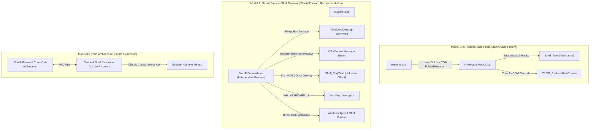

# StartAllForward — Architectural Options & System Design

This document contrasts the core architectural strategies for **StartAllForward** to determine the optimal balance of stability, capability, safety, and development velocity.

---

## 1. Architectural Models Comparison



---

## 2. Model Evaluation & Trade-off Analysis

### Architecture Model 1: In-Process Shell Injection (The Reference Approach)
- **Mechanism**: Register a COM class under `Drive\shellex\FolderExtensions` to force `explorer.exe` to load our DLL on startup. Once in-process, overwrite virtual method tables, hook private unexported functions in `twinui.pcshell.dll`, `taskbar.dll`, and `explorerframe.dll`, and hijack `Shell_TrayWnd`.
- **Advantages**:
  - Direct access to internal Explorer data structures and window handles.
  - Native integration with the existing system tray without forwarding messages.
- **Critical Disadvantages & Risks**:
  - **Severe Crash Vulnerability**: A null-pointer dereference or unhandled exception crashes `explorer.exe`, resulting in a desktop crash loop or black screen.
  - **Fragile Across OS Updates**: Windows 11 Cumulative Updates (Patch Tuesday) frequently change internal unexported class offsets and functions. Every Windows update risks bricking the shell.
  - **High Reverse-Engineering Burden**: Requires continuous disassembling of private symbols on every Windows build.
  - **Violates Clean-Room & Safety Constraints**: In-process memory injection carries high security scrutiny and antivirus false-positive rates.

---

### Architecture Model 2: Out-of-Process Shell Daemon (The Recommended Approach)
- **Mechanism**: StartAllForward runs as an independent, unprivileged user process (`StartAllForward.exe`). It creates its own borderless AppBar window docked to the chosen screen edge, hides or shifts the default Windows 11 taskbar using standard Win32 calls, and tracks running windows using `RegisterShellHookWindow` and `SetWinEventHook`.
- **Advantages**:
  - **100% Crash-Safe**: If StartAllForward encounters an unexpected exception, `explorer.exe` remains completely unaffected. Windows immediately unhides the native taskbar. Zero risk of bricking the system.
  - **Complete OS Upgrade Immunity**: Relies exclusively on public, stable Win32 and COM APIs (`SHAppBarMessage`, `RegisterShellHookWindow`, `ITaskbarList3`, `IShellItem`). Windows updates will not break the core engine.
  - **Zero Elevated Privileges Required**: Runs entirely in user-space (`HKCU`). Does not touch system directories or require Administrator rights.
  - **Fast, Independent Development**: UI can be built and iterated with modern XAML/WPF tooling, hot reload, and automated unit testing.
- **Challenges & Mitigations**:
  - *System Tray*: Out-of-process tray hosting requires careful handling. *Mitigation*: In the MVP, StartAllForward can dock alongside the native notification area or utilize standard notification icon delegation.

---

### Architecture Model 3: Hybrid Architecture (Long-Term Expansion)
- **Mechanism**: The core Taskbar and Start Menu execute out-of-process (Model 2). An optional, user-activated COM shell extension DLL provides classic context menu integration and file explorer enhancements.
- **Advantages**: Combines absolute desktop safety with native explorer context extensions.
- **Recommended Timing**: Reserved for post-MVP milestones.

---

## 3. System Design for StartAllForward (Model 2)

```
StartAllForward System Architecture
┌────────────────────────────────────────────────────────┐
│                      UI Presentation                   │
│   ┌───────────────────────┐   ┌────────────────────┐   │
│   │   TaskbarView.xaml    │   │  StartMenuView.xaml│   │
│   │  (AppBar, Buttons,    │   │  (Dual-Column,     │   │
│   │   Tray, Clock, Orbs)  │   │   Search, Pins)    │   │
│   └───────────┬───────────┘   └─────────┬──────────┘   │
├───────────────┼─────────────────────────┼──────────────┤
│               │      Core ViewModels    │              │
│   ┌───────────▼───────────┐   ┌─────────▼──────────┐   │
│   │   TaskbarViewModel    │   │ StartMenuViewModel │   │
│   │   (Layout, Monitors)  │   │ (MRU, Index, Apps) │   │
│   └───────────┬───────────┘   └─────────┬──────────┘   │
├───────────────┼─────────────────────────┼──────────────┤
│               │     Services Engine     │              │
│   ┌───────────▼───────────┐   ┌─────────▼──────────┐   │
│   │ WindowTrackerService  │   │  ShellIndexService │   │
│   │ (RegisterShellHook,   │   │  (AppsFolder, .lnk │   │
│   │  SetWinEventHook)     │   │   Settings Search) │   │
│   └───────────┬───────────┘   └─────────┬──────────┘   │
├───────────────┴─────────────────────────┴──────────────┤
│                     Native Interop                     │
│  ┌───────────────────┐ ┌───────────────┐ ┌──────────┐  │
│  │  AppBarManager    │ │ LowLevelHook  │ │ COM Shell│  │
│  │  (SHAppBarMessage)│ │ (Win-Key Hook)│ │ Activation  │
│  └───────────────────┘ └───────────────┘ └──────────┘  │
└────────────────────────────────────────────────────────┘
```

### Safety & Fail-Safe Recovery Mechanisms
1. **Emergency Exit Hotkey**: Global hotkey (`Ctrl + Shift + Win + Escape`) immediately terminates StartAllForward and calls `ShowWindow(hNativeTaskbar, SW_SHOW)` to restore the default Windows shell.
2. **Unhandled Exception Guard**: Global exception handlers in the application lifecycle (`AppDomain.CurrentDomain.UnhandledException`, `DispatcherUnhandledException`) restore the native shell before terminating.
3. **Single-Instance Mutex**: Prevents multiple overlapping instances.
4. **Heartbeat / Watchdog Check**: If the process crashes or is killed via Task Manager, Windows automatically detects the unreserved AppBar and resets the work area.
