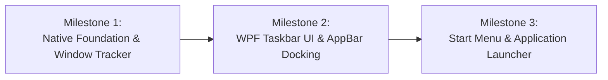

# StartAllForward — MVP Recommendation & Implementation Roadmap

## 1. MVP Vision & Principles

The MVP (Minimum Viable Product) for **StartAllForward** is designed to deliver immediate, tangible productivity improvements on Windows 11 while strictly prioritizing **system safety, zero shell corruption risk, and reliable operation** over secondary cosmetic skinning.

### Core MVP Principles
1. **Genuinely Usable**: Solves the single most requested desktop productivity limitation: uncombined taskbar buttons with full application text labels and flexible screen positioning.
2. **100% Non-Destructive**: Runs entirely out-of-process in standard user mode. Does not inject into `explorer.exe`, does not patch system binaries, and does not alter system-wide registry hives.
3. **Bulletproof Recovery**: If closed, killed, or uninstalled, the native Windows 11 taskbar instantly reappears. Includes an emergency global recovery hotkey.
4. **Clean-Room Modular Foundation**: Establishes a clean, modern codebase that can be incrementally expanded with themes, Start Menu layouts, and advanced tray flyouts.

---

## 2. MVP Scope Definition

### Included in MVP (Release 0.1)

#### 1. Out-of-Process Taskbar Engine
- **Edge Docking**: Dock to Bottom or Top edge of the primary monitor via `SHAppBarMessage`.
- **Desktop Work Area Management**: Maximized application windows cleanly stop at the taskbar boundary without overlapping or hiding controls.
- **Window Button Management**:
  - Live tracking of open top-level windows via `RegisterShellHookWindow` and `SetWinEventHook`.
  - Full application text labels alongside high-resolution icons (ungrouped / "Never combine" mode).
  - Left-click to activate / minimize window; right-click context menu with Close, Minimize, Maximize.
  - Active window highlighting, mouse hover styling, and flashing state notifications (`HSHELL_FLASH`).
- **Start Orb & Basic Launcher**:
  - Start button integrated on the taskbar.
  - Left-click or single press of the Windows Key toggles a clean application launcher menu displaying installed applications (`shell:AppsFolder` and Start Menu shortcuts) and quick search.
- **System Clock & Basic Tray Area**:
  - Accurate local time and date display.
  - Clicking the clock invokes the native Windows calendar flyout.
- **Fail-Safe & Safe Exit**:
  - Emergency escape hotkey: `Ctrl + Shift + Win + Escape` instantly restores the native Windows 11 taskbar and exits cleanly.
  - Clean exit from taskbar right-click menu.

### Explicitly Excluded from MVP (Deferred to v0.2+)
- *Multi-monitor secondary taskbars* (v0.2).
- *File Explorer ribbon / command bar replacement* (deferred due to in-process risk).
- *Delphi-style custom `.msstyles` skin parsing* (vector XAML theming is prioritized).
- *DarkMagic-style control injection into third-party Win32 apps*.

---

## 3. The Three Highest-Priority Implementation Milestones

### Milestone 1: Native Shell Engine & Window Tracking Pipeline
- **Objective**: Establish the core background service that monitors the OS window lifecycle and captures shell events with zero UI latency.
- **Key Deliverables**:
  1. Win32 message pump with `RegisterShellHookWindow` integration (`HSHELL_WINDOWCREATED`, `HSHELL_WINDOWDESTROYED`, `HSHELL_WINDOWACTIVATED`, `HSHELL_REDRAW`, `HSHELL_FLASH`).
  2. `WindowTrackerService`: In-memory reactive collection of active application windows, extracting window titles (`GetWindowTextW`), process identity (`GetWindowThreadProcessId`), and icons (`WM_GETICON` / `GCLP_HICON`).
  3. Low-level keyboard hook (`WH_KEYBOARD_LL`) to cleanly intercept single Windows Key presses without interfering with system shortcuts (Win+L, Win+E, Win+R).
  4. Emergency failsafe hotkey handler.

### Milestone 2: WPF Taskbar Shell Window & AppBar Manager
- **Objective**: Render the high-performance desktop taskbar and integrate with the Windows desktop work area.
- **Key Deliverables**:
  1. `AppBarManager`: Encapsulates `SHAppBarMessage(ABM_NEW)`, `ABM_SETPOS`, and `ABM_REMOVE`. Resizes the desktop work area to accommodate top/bottom positioning.
  2. WPF hardware-accelerated taskbar view with MVVM data-binding to the `WindowTrackerService`.
  3. Window buttons with dynamic text truncation, active state styling, and window manipulation commands (`ShowWindow`, `SetForegroundWindow`).
  4. Clean hide/restore integration with the native Windows 11 taskbar (`Shell_TrayWnd`).

### Milestone 3: Modular Start Menu & Application Launcher
- **Objective**: Provide a responsive, searchable application launcher triggered by the Start button or Windows Key.
- **Key Deliverables**:
  1. `ShellIndexService`: Asynchronously enumerates installed desktop shortcuts (`FOLDERID_CommonPrograms`, `FOLDERID_Programs`) and packaged applications (`shell:AppsFolder`).
  2. Dual-column Start Menu popup view with pinned apps, All Programs list, and power controls (Shutdown, Restart, Lock).
  3. Fast search input with real-time filtering of applications and settings deep-links (`ms-settings:*`).
  4. Packaging and single-file publish setup (.NET 9 self-contained executable).
